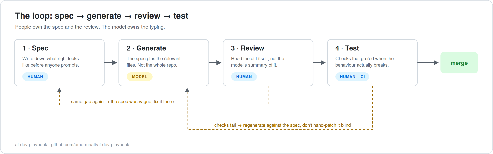

# ai-dev-playbook

A working playbook for engineering teams that use AI coding tools. One core loop, five short guides, and a folder of templates you can copy into a real project this week.

I wrote this because most of what teams get handed on this subject is either vendor marketing or a blanket ban. Neither survives contact with a delivery deadline. What does survive is process: a small set of habits that let you take the speed without inheriting a codebase nobody can explain.

## Where this comes from

I've spent about fifteen years as a solution architect on enterprise systems, and the last stretch of that with AI in the loop for real builds. The habits in this repo weren't invented for it. They're the ones that held up across my own projects, and a few of them exist because of things that went wrong.

An example, because it shaped the whole testing chapter. I ran a guardrail mutation test over two of my own agent projects using [llmcheck](https://github.com/omarmaali/llmcheck), a small reliability toolkit I built. It disables each safety guardrail in turn and re-runs the test suite. Four guardrails across the two repos turned out to have tests that couldn't fail: the tests set the relevant values directly, on a settings object or as an argument, so the toggle the guardrail depends on in production never reached the code under test. Every one of those guardrails had a test. Every one had passed review. That's the failure mode this playbook is built around: AI-assisted code that looks finished and reviewed, and isn't.

## The loop

| Stage | Owner | The short version |
|---|---|---|
| **Spec** | Human | Every gap in the spec is a decision you just delegated to the model without noticing. |
| **Generate** | Model | One task per session, with the spec and the relevant files. Not the whole repo. |
| **Review** | Human | Read the diff. The model's description of the diff doesn't count as reading it. |
| **Test** | Human + CI | A test that stays green when the behaviour breaks isn't testing anything. |

The reasoning behind each stage, and what to do when the loop kicks a task backwards, is in [docs/01-workflow.md](docs/01-workflow.md).

## What's in the repo

**Guides**, meant to be read in order the first time:

1. [The workflow](docs/01-workflow.md). The four stages, why each exists, and the loop-back rules.
2. [Reviewing AI-generated code](docs/02-reviewing-ai-code.md). How model failures differ from human failures, and how to run the review.
3. [Security, IP and governance](docs/03-security-and-ip.md). What never goes into a prompt, tool tiers by data class, licensing in both directions.
4. [Evaluating AI-generated code](docs/04-evaluating-ai-code.md). The quality bar, red flags, and what's worth measuring at team level.
5. [Team onboarding](docs/05-team-onboarding.md). A rollout plan that doesn't mandate anything, and the anti-patterns that sink adoptions.

**Templates**, in [/templates](templates). Copy them into your own repo and edit:

- [task-spec.md](templates/task-spec.md), the one-page spec that drives the loop, with a filled example
- Prompt templates for the recurring jobs: [implement from spec](templates/implement-from-spec.md), [refactor](templates/refactor.md), [write tests](templates/write-tests.md), [review a diff](templates/review-a-diff.md), [debug](templates/debug.md)
- [ai-code-review-checklist.md](templates/ai-code-review-checklist.md), the reviewer's pass for AI-authored diffs
- [team-working-agreement.md](templates/team-working-agreement.md), a one-page policy your team can actually read: approved tools, data rules, review rules, incident rule

## How to use it

If you're one developer: take `task-spec.md` and the review checklist, run one real task through the full loop, and see what the spec stage catches.

If you're leading a team: read guides 1 and 3, adapt the working agreement to your tools and data, then follow the rollout plan in guide 5. Resist the urge to adopt everything at once. The teams I've seen succeed started with two or three task classes and a pilot group.

Everything here is tool-agnostic. It assumes an assistant that can read files and produce diffs, and nothing more specific than that.

## What this playbook is not

It's not legal advice. The security and IP guide is an engineer's view of the risks; your counsel reviews your policy, not a stranger's repo.

It's not a benchmark report. You won't find "teams ship N% faster" claims here. I don't have numbers I'd defend on that, and I haven't seen anyone else's I'd defend either. What I can defend are the failure modes, because I've hit them.

And it's not tied to any vendor. No tool is named as required, and no tool paid for a mention.

## License

MIT. Take the templates, strip the attribution, ship them internally.
