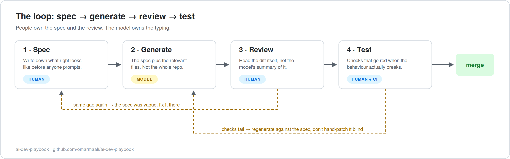

# The workflow

The loop is spec, generate, review, test. None of those words are new. What's new is the pressure to skip them: an AI assistant makes the undisciplined path frictionless. You can go from a vague sentence to five hundred plausible lines in a minute, and every step you skipped is still missing, just invisible now.

So this playbook doesn't ask a team to learn a new methodology. It asks them to keep the one they already claim to follow, at the scale of a single task, with the model doing the typing in the middle.

## 1 · Spec

The unit of work is a task spec: one page, usually much less. The template is [templates/task-spec.md](../templates/task-spec.md) and it has six sections: task, context, contract, constraints, out of scope, acceptance checks.

Here's why it earns its place. A model never leaves a gap open. Ask for "retry logic on the payment client" and somebody still has to decide how many retries, which errors are retryable, what backoff shape, whether retries log, and what happens when they run out. If those decisions aren't in the spec, the model makes them for you, and it makes them plausibly, which is worse than making them badly: a bad default gets caught in review and a plausible one sails through.

Some of what goes in the spec, and the reasoning:

- **Contract before code.** Inputs, outputs, observable behaviour. If you can't state the contract, the task isn't ready for a model. It probably isn't ready for a person either, but a person would come ask you.
- **Pinned versions.** Name the language version, the framework version, the library versions that matter. Model training data lags; given the choice it will happily write for an API two versions old.
- **Out of scope, written down.** Models drift into "improvements" nobody asked for. An explicit out-of-scope list turns that drift from a judgement call in review into a mechanical reject.
- **Acceptance checks.** Two to six statements you could turn into tests without further discussion. This section is also the readiness test for the spec itself: if you can't write the checks, you've found the ambiguity early, which is the cheapest place to find it.

The spec has a second life. It's the review artifact, and six months later it's the written answer to "what was this supposed to do".

## 2 · Generate

The model's stage. The craft here is context discipline, and it's mostly subtraction.

**One task per session.** Long conversations accumulate stale constraints and half-abandoned directions, and the model weights all of it. When a task is done, start clean. It costs you a paste of the spec and saves you an argument with a context window.

**Give it the spec, the files it will touch, and the interfaces it must call.** Not the whole repository. A model with your entire codebase in view starts pattern-matching against everything, including code you'd rather it didn't imitate, and it gets slower and vaguer as context grows. Curating three to eight files takes a minute and is the highest-leverage minute in this stage. The team-facing version of this rule also has a security angle, covered in [guide 3](03-security-and-ip.md).

**Plan before code, for anything non-trivial.** Ask for the approach first: what files change, what the shape of the change is, what it won't touch. It's much cheaper to correct an approach than a finished diff. The [implement-from-spec template](../templates/implement-from-spec.md) builds this in.

**Know when to stop.** Certain behaviours mean the session is done and the spec needs work, not the conversation: the model rewrites files outside its list, invents an API and defends it, or keeps "fixing" things you didn't raise. Arguing with drift wastes more time than restarting with a tighter spec. Restarting is normal here.

**If the tool is an agent.** An agent that explores the repository on its own makes the curation advice above only half true: it chooses its own context and it reads whatever it can reach. Two things take curation's place. The first is the project instruction file (`CLAUDE.md`, `AGENTS.md`, `.cursorrules`, whichever your tool reads). It loads into every session, so it's where the team's conventions, the never-touch list and the test command belong, and the easiest way to keep it honest is to commit the [working agreement](../templates/team-working-agreement.md) there, or a trimmed copy of it. The second is the tool's ignore file, which decides what the agent can read at all; guide 3 says what goes in it. Plan-first matters more with an agent, since the diff arrives already written, tested and summarised, and the plan is the last point where a correction is cheap.

**Usage is a shared budget.** On a team account, one developer's long, repository-wide session draws on the same pool as everyone else's work. One task per session and a tight file list were written above as quality rules; they're also the cheapest way to run the tool. A team that hits its limit mid-week should look at session length and context size before it asks for more seats.

## 3 · Review

Human stage, and the one where AI-assisted work most often fails without anyone noticing at the time.

The core discipline is short: **review the diff, not the summary.** Models produce confident, well-written descriptions of their changes, and the description is sometimes wrong. It's the code that ships.

The second discipline: hold the line on explanation. If a reviewer can't explain what a line is for, the line doesn't merge. This rule predates AI and nobody enforced it much, because the author could always explain. With generated code there may be no human who understands the line, and the reviewer is the last chance to notice that.

What makes reviewing model output a different job from reviewing a colleague's, and the specific failure modes worth hunting (invented APIs, requirement drift, swallowed errors, scope creep), is [guide 2](02-reviewing-ai-code.md). The mechanical version is the [review checklist](../templates/ai-code-review-checklist.md).

Budget for it: reviewing an AI diff to this standard is slower per line than reviewing a trusted colleague, especially at first. That cost is real. It's also the whole insurance premium, and it's still cheaper than writing the code yourself.

## 4 · Test

The acceptance checks from the spec become the tests.

Ownership matters more here than authorship. The model can draft tests, and it's good at the tedious parts, but the person who owns the task decides what gets asserted. Letting the same session that wrote the code also decide what the tests check means any blind spot in the code has a matching blind spot in its tests. The two artifacts fail together, which is exactly what a test suite exists to prevent.

The bar for a test: it fails when the behaviour breaks. Not "it exercises the code", not "it asserts the config flag is on". I keep returning to the mutation result from the README because it's the cleanest evidence I have: four guardrails in my own projects, each with a passing test, and disabling any of them changed nothing. The way to know is to break the behaviour on purpose and watch. Delete the guardrail, loosen the threshold, disable the flag; if the suite stays green, the test was decoration. [llmcheck](https://github.com/omarmaali/llmcheck) automates that, but the mindset costs nothing and applies with any tooling.

Keep the suite fast and runnable offline. A suite that needs a paid API key to run is a suite that runs less often, and in CI it becomes a suite with a flaky external dependency.

## When the loop kicks back

Failures at review or test get classified before they get fixed, because the two kinds route differently.

**A generation miss**: the spec was clear and the model didn't meet it. Regenerate against the same spec, quoting the failing check. Usually converges in one pass.

**A spec gap**: the code is wrong because the spec allowed it to be. Fix the spec, then regenerate. The tempting shortcut is to hand-patch the output and move on, and the reason not to is that the ambiguity is still in the spec, waiting for the next change to the same code. The diagram's dashed arrows are these two routes.

A caveat. Sometimes hand-editing is simply faster, and pretending otherwise would make this playbook something people route around. Edit when it's faster. The rule that survives contact with practice is narrower: whatever you edit, you own. The explanation bar from review applies to every line that merges, whoever or whatever typed it, and if you hand-patched around a spec gap, note the gap in the spec before you close the task.
